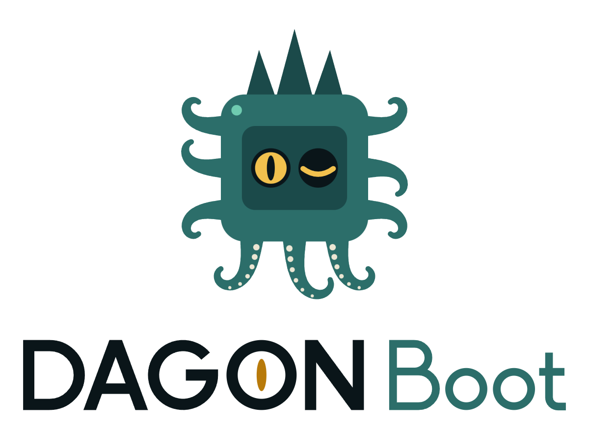
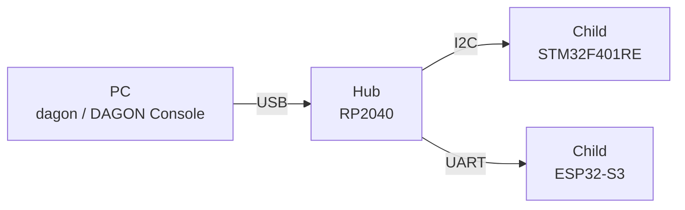
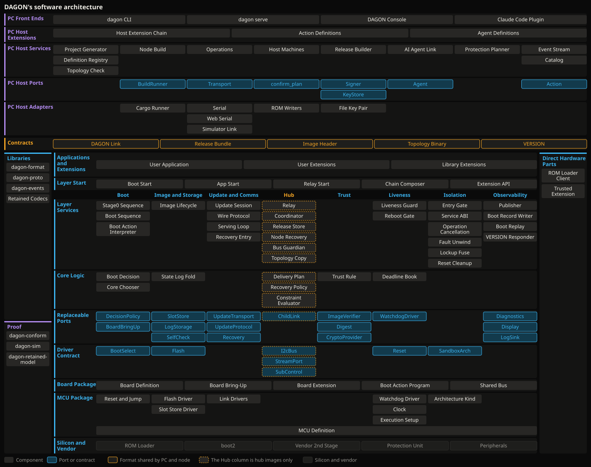

<p align="center">
  <picture>
    <source media="(prefers-color-scheme: dark)" srcset="assets/product-symbol/lockup-vertical-dark-1200w.png">
    
  </picture>
</p>

<p align="center"><b>The distributed microcontroller designs of professionals, in more people's hands. As microcontrollers are added, writing takes no more work, and it stays safe.</b></p>

<p align="center">
  <a href="https://c-ardinal.github.io/DAGON-Boot/demo/">Try the demo</a> ·
  <a href="https://c-ardinal.github.io/DAGON-Boot/doc/en/">Developer documentation</a> ·
  <a href="README.md">日本語 Readme</a> ·
  License: MIT or Apache-2.0
</p>

> [!IMPORTANT]
> As of November 8, 2026, this is an alpha that supports only three kinds of microcontroller, made for "Built with Claude: Japan 2026".
> Please understand that breaking changes may be made before the official release.

## What is DAGON?

A beautiful design with a muddy operation.

[](https://www.youtube.com/watch?v=9SH4c6mgJNY)

A product can give each of its microcontrollers the role that suits it best and have them work together well. Even so, changing a program can mean taking the product apart and swapping cables, or struggling with a different write tool for each microcontroller. To get around this, people build their own way of changing programs, or compromise the design because operating it is too hard.

DAGON makes the distributed microcontroller designs that professionals and specialists use workable for a wide range of people, from those starting electronics with AI to individual developers who do not compromise on design.

The first time only, you connect each microcontroller directly, one at a time, and write its factory image. After that, one connection is enough, and you do not need to connect them one at a time.
Through one microcontroller connected to your PC, you write to the microcontrollers beyond it with a single operation. More microcontrollers take more time; the operation does not grow.

Update images are all signed and written safely. A microcontroller starts a new version on trial and goes back by itself to the previous version, where a slot holds one, if it does not work. If a write stops part-way, an image with two slots keeps its running version; for an image with one slot, the image that writes it stays and can receive it again. The MCU definition gives each kind of image one slot or two.

DAGON handles mixed kinds of microcontroller once you draw the setup. As a developer you choose the boards, draw how they connect and write your application. DAGON takes care of start-up, flash layout, signing and the writing steps.

## Documentation

- [Getting started](https://c-ardinal.github.io/DAGON-Boot/doc/en/getting-started/): try it, install, from a new project to a new version
- [How-to guides](https://c-ardinal.github.io/DAGON-Boot/doc/en/how-to/): your own board, swapping a link, AI help
- [Explanation](https://c-ardinal.github.io/DAGON-Boot/doc/en/explanation/): what the words mean, events and extensions, versioning rules
- [Reference](https://c-ardinal.github.io/DAGON-Boot/doc/en/reference/): commands, HTTP API, events, definition formats, Rust API

## Features

- **Draw the setup**: In DAGON Console, which runs in your browser, you draw the microcontrollers and their links as a graph. Wiring and pins are checked at every edit.
- **Get a project that builds**: `dagon new` and `dagon gen` make a Rust crate for each microcontroller, with its start-up, its wiring and an empty `app.rs` for your code.
- **Write in one go**: `dagon deploy` goes from building and signing through making the package to writing, all in one go. In DAGON Console you write while following each microcontroller's progress graphically.
- **Go back when it fails**: Every image is signed. A microcontroller starts a new version on trial, and an image with two slots goes back to the previous version when the new one cannot be confirmed. `dagon rollback` goes back by hand.
- **Write the boot loader too**: The boot loader itself lives in slots and is written like an app. With two slots, the previous one comes back if the new one does not work; with one, the confirmed app starts and writes the boot loader again.
- **Extend DAGON**: Without changing DAGON's source, add extensions that receive events, answer decisions and replace parts (ports).
- **Get help from AI**: A new project comes with Claude Code instructions and skills. `dagon ai link` connects an agent with your consent. The API key stays in the OS credential store.

Every step can also be done with the `dagon` command.

## Supported hardware

| MCU         | Board                           |
| ----------- | ------------------------------- |
| RP2040      | Waveshare RP2040-Touch-LCD-1.28 |
| STM32F401RE | NUCLEO-F401RE                   |
| ESP32-S3    | M5StopWatch                     |

## Try it

### Without installing

In the browser (Chrome or Edge 89 or later), try the [DAGON Console demo](https://c-ardinal.github.io/DAGON-Boot/demo/) with no install and no hardware. You write to a simulated hub and its children and go back to a previous version. Reading and writing files, connecting real devices and AI link operations are not available in the demo.

### Install and try

On your own PC, you can also try it without hardware, using the simulator.

#### Install

Linux / macOS

```sh
curl -fsSL https://raw.githubusercontent.com/c-ardinal/DAGON-Boot/main/setup.sh | sh
```

Windows

```powershell
irm https://raw.githubusercontent.com/c-ardinal/DAGON-Boot/main/setup.ps1 | iex
```

#### Uninstall

The same script removes it. The keys in `~/.dagon` are kept; if you delete them, nodes written with those keys can no longer be updated.

```sh
curl -fsSL https://raw.githubusercontent.com/c-ardinal/DAGON-Boot/main/setup.sh | sh -s -- --uninstall
```

```powershell
$env:DAGON_UNINSTALL = "1"; irm https://raw.githubusercontent.com/c-ardinal/DAGON-Boot/main/setup.ps1 | iex
```

The environment variable `DAGON_UNINSTALL=1` works too. The PowerShell script clears this variable when it runs.

#### Try it in the simulator

```sh
dagon sim # runs end-to-end scenarios in the simulator
```

## Start your own project

```sh
dagon new my-fleet  # generates the files a project needs
cd my-fleet
dagon serve         # starts DAGON Console; draw the setup in the browser
dagon doctor        # checks that the setup can be built
```

`dagon doctor` checks the tools the microcontrollers in the setup need ([list](https://c-ardinal.github.io/DAGON-Boot/doc/en/reference/tools/)), and `dagon doctor --fix` installs those that need no administrator rights.

From building to the first write, see [From a new project to a new version](https://c-ardinal.github.io/DAGON-Boot/doc/en/getting-started/first-project/).

You can also add DAGON to existing firmware ([steps](https://c-ardinal.github.io/DAGON-Boot/doc/en/how-to/existing-firmware/)).

## How writing works

The microcontroller connected to your PC over USB is the hub. The microcontrollers beyond it are its children.

The figure below is the sample setup.



1. The PC checks the package's signatures and that the package fits this setup.
2. Through the hub, the PC sends each microcontroller its new image. Children come first and the hub last.
3. A microcontroller writes the new image to a slot other than the running one.
4. The microcontroller starts the new image on trial.
5. The PC sends CONFIRM, and the microcontroller confirms the new version when its self-check (`self_check`) answers healthy. An image that is not confirmed is reset and, with two slots, goes back to the previous version.

Each step reaches extensions as an event, and extensions answer the decision points (accepting an update, when to reboot, the self-check). A microcontroller can also confirm by itself instead of the PC (`Confirm::Own`).

What DAGON does not do by design, what the user is responsible for, and where the code differs from the design are in [Limitations](https://c-ardinal.github.io/DAGON-Boot/doc/en/explanation/limitations/).

## DAGON's design information

### Software architecture



### Reference for using DAGON

| To do this | Touch | Steps |
| --- | --- | --- |
| Write your app | `nodes/<id>/src/app.rs` | [From a new project to a new version](https://c-ardinal.github.io/DAGON-Boot/doc/en/getting-started/first-project/) |
| Add an extension | `extensions/<id>/dagon-extension.toml`, `[extensions]` in `dagon.toml` | [Extension manifest](https://c-ardinal.github.io/DAGON-Boot/doc/en/reference/extension-manifest/) |
| Add an agent | `~/.dagon/agents/*.toml` | [Agent definition format](https://c-ardinal.github.io/DAGON-Boot/doc/en/reference/agent-definition/) |

### Reference for changing DAGON itself

| To do this | Touch | Steps |
| --- | --- | --- |
| Add a board | `targets/boards/*/dagon-board.toml` | [Your own board](https://c-ardinal.github.io/DAGON-Boot/doc/en/how-to/own-board/) |
| Add an MCU | `targets/mcu/<id>/` | [Adding an MCU or a link](https://c-ardinal.github.io/DAGON-Boot/doc/en/how-to/new-mcu-or-link/) |
| Add a link or transport | `crates/dagon-format/src/link.rs`, `targets/mcu/*/src/links.rs`, `crates/dagon-host/src/lib.rs` | [Adding an MCU or a link](https://c-ardinal.github.io/DAGON-Boot/doc/en/how-to/new-mcu-or-link/) |

### Building DAGON yourself

Install the `dagon` command with the scripts under "Install" above or from an archive of a [release](https://github.com/c-ardinal/DAGON-Boot/releases). Both have DAGON Console built in.

To build it from a clone of this repository, you need:

- Rust 1.95.0 or later
- A C compiler (the Visual Studio 2022 C++ build tools on Windows, gcc 13 or later on Linux, Xcode Command Line Tools 16.4 or later on macOS)
- For the DAGON Console page: Python 3, Node.js and npm, and `wasm-pack` 0.15.1

Build the page first. Without it, `dagon serve` only tells you how to build the page.

```sh
python scripts/page.py build
cargo install --path crates/dagon-cli
```

To remove it, run `cargo uninstall dagon-cli`.

## Dependencies and external data

- Written for this project: `crates/` (except the test data below), `targets/` (except the vendor parts below), `web/`, `site/`, `samples/`, `plugin/`, `topology/`, `scripts/`
- Libraries: Rust and npm libraries, used unmodified (embassy, esp-hal, ed25519-compact, Svelte, Vite, Astro and others).
- Vendor parts: the ESP-IDF 2nd stage, `rp2040-boot2`, the STM32F401 ROM boot loader
- Test data: the Project Wycheproof Ed25519 test vectors (Apache License 2.0, <https://github.com/C2SP/wycheproof>) and the RFC 8032 test vectors, unmodified with their provenance in `crates/dagon-ed25519/tests/vectors/`.
- Fonts and icons: Doto, DotGothic16, Zen Kaku Gothic New, JetBrains Mono (SIL OFL 1.1), Lucide (ISC)
- Values in the MCU and board definitions: taken from the makers' datasheets and board documents. A value whose source has not been checked is marked `unverified` in the definition.

The list and licences are in [Licenses](https://c-ardinal.github.io/DAGON-Boot/doc/en/reference/licenses/).
