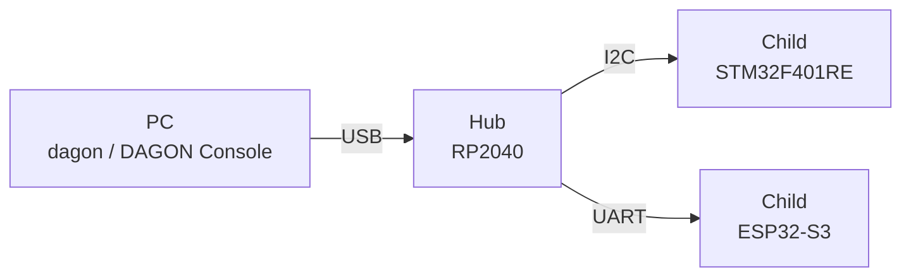

<p align="center">
  <picture>
    <source media="(prefers-color-scheme: dark)" srcset="assets/product-symbol/lockup-horizontal-dark-2400w.png">
    
  </picture>
</p>

<p align="center"><b>Safely write new programs to a group of connected microcontrollers from your PC</b></p>

<p align="center">
  <a href="https://c-ardinal.github.io/DAGON-Boot/demo/">Try the demo</a> ·
  <a href="https://c-ardinal.github.io/DAGON-Boot/doc/en/">Documentation</a> ·
  <a href="README.md">日本語</a> ·
  License: MIT or Apache-2.0
</p>

> [!IMPORTANT]
> As of November 8, 2026, this is an alpha that supports only three kinds of microcontroller, made for "Built with Claude: Japan 2026". Please understand that breaking changes may be made before the official release.


## What is DAGON?

When you build something from a few microcontrollers (small computers), you will want to change their programs afterwards. Opening the case and reconnecting cables each time is hard work, and a failed write can leave a board dead.

With DAGON, one microcontroller on your PC's USB (the hub, 親機) passes new versions on to the others (the children, 子機). If a write stops part-way, the running version stays; if a new version does not work, the node goes back to the previous one by itself.

As a developer you choose the boards, draw how they connect and write your application in Rust. DAGON takes care of start-up, flash layout, signing and the writing steps.

## Features

- **Draw the setup**: DAGON Console, in your browser, shows the nodes and their links as a graph and checks wiring and pins as you edit.
- **Get a project that builds**: `dagon new` and `dagon gen` give every node a Rust crate with its start-up, its wiring and an empty `app.rs` for your code.
- **Write in one go**: `dagon deploy` or the Console builds, signs, packages and writes in one action, with each node's progress in view.
- **Go back when it fails**: every image is signed. A node runs a new version on trial and goes back when it cannot be confirmed; `dagon rollback` goes back by hand.
- **Extend it**: without changing DAGON's source, add extensions that receive events, answer decisions and replace parts (ports).
- **Ask an AI**: a new project comes with Claude Code instructions and skills, and `dagon ai link` connects an agent with your consent.

Every step is also a `dagon` command.

## Supported hardware

| MCU | Boards with a definition |
|---|---|
| RP2040 | Waveshare RP2040-Touch-LCD-1.28 |
| STM32F401RE | NUCLEO-F401RE |
| ESP32-S3 | M5StopWatch |

The hub is an RP2040. Other boards work by choosing their MCU ([your own board](https://c-ardinal.github.io/DAGON-Boot/doc/en/how-to/own-board/)). The full list is in [Boards and MCUs](https://c-ardinal.github.io/DAGON-Boot/doc/en/reference/boards/).

## Try it

In your browser, try the [DAGON Console demo](https://c-ardinal.github.io/DAGON-Boot/demo/). It needs no install and no hardware: you write to a simulated hub and its children and go back to a previous version. File input and output, device connection and API keys are not available in the demo.

On your own PC, also without hardware:

```sh
cargo install --git https://github.com/c-ardinal/DAGON-Boot --tag cli-v0.1.0 dagon-cli
dagon demo
```

`dagon demo` opens the Console at the address it prints. `dagon sim run` runs end-to-end scenarios in the simulator.

## Prerequisites

- [Rust](https://rustup.rs) (and a C compiler when building from source)
- Chrome or Edge 89 or later to connect real boards (it uses Web Serial)
- `dagon doctor` checks the tools each MCU needs ([list](https://c-ardinal.github.io/DAGON-Boot/doc/en/reference/tools/))

Installing from the release archives is in [Install](https://c-ardinal.github.io/DAGON-Boot/doc/en/getting-started/install/).

## Start your own project

```sh
dagon new my-fleet
cd my-fleet
dagon doctor
dagon serve
```

`dagon new` makes `dagon.toml`, the topology file (the three-node sample) and a signing key pair, with the secret key outside the project. Open the address `dagon serve` prints to go on in the Console. From building to the first write, see [From a new project to an update](https://c-ardinal.github.io/DAGON-Boot/doc/en/getting-started/first-project/).

You can also add DAGON to existing firmware ([how](https://c-ardinal.github.io/DAGON-Boot/doc/en/how-to/existing-firmware/)).

## How it works



1. The PC checks the signed package's signatures and topology, and sends it to the hub.
2. The hub relays to the children. Children are written first and the hub last.
3. A node writes the new image beside the running one and starts it on trial.
4. When its self-check passes it confirms; otherwise a watchdog reset takes it back to the previous version.

> [!WARNING]
> What has been checked on hardware is in [Limitations](https://c-ardinal.github.io/DAGON-Boot/doc/en/explanation/limitations/). Power cuts and writing the F401 through its ROM have not been run on hardware. Signing keys are files on the PC; there is no hardware root of trust.

## Dependencies and external data

- Written for this project: `crates/`, `targets/` (except the vendor parts below), `web/`, `site/`, `samples/`, `plugin/`, `topology/`, `scripts/`
- Libraries: Rust crates and npm packages, used unmodified (embassy, esp-hal, ed25519-compact, Svelte, Vite, Astro and others)
- Vendor parts: the ESP-IDF 2nd stage, `rp2040-boot2`, the STM32F401 ROM boot loader
- Fonts and icons: Doto, DotGothic16, Zen Kaku Gothic New, JetBrains Mono (SIL OFL 1.1), Lucide (ISC)
- Values in the MCU and board definitions: taken from the makers' datasheets and board documents, with the source in comments in the definition files

The full list and licences are in [Licenses](https://c-ardinal.github.io/DAGON-Boot/doc/en/reference/licenses/).

## Documentation

- [Getting started](https://c-ardinal.github.io/DAGON-Boot/doc/en/getting-started/): try it, install, from a new project to an update
- [How-to guides](https://c-ardinal.github.io/DAGON-Boot/doc/en/how-to/): your own board, swapping a link, AI help
- [Explanation](https://c-ardinal.github.io/DAGON-Boot/doc/en/explanation/): words, events and extensions, versioning rules
- [Reference](https://c-ardinal.github.io/DAGON-Boot/doc/en/reference/): commands, HTTP API, events, definition formats, Rust API
