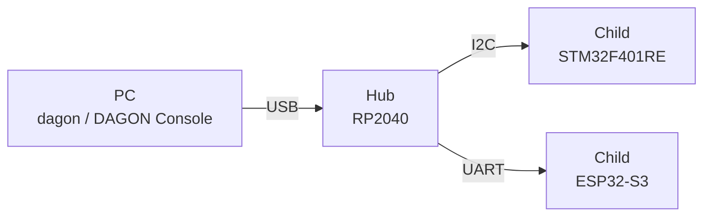
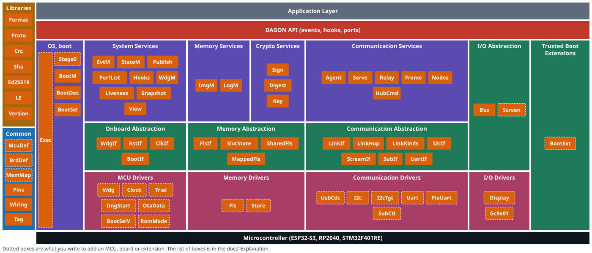

<p align="center">
  <picture>
    <source media="(prefers-color-scheme: dark)" srcset="assets/product-symbol/lockup-horizontal-dark-2400w.png">
    
  </picture>
</p>

<p align="center"><b>The distributed microcontroller designs of professionals, in more people's hands. As microcontrollers are added, writing takes no more work, and it stays safe.</b></p>

<p align="center">
  <a href="https://c-ardinal.github.io/DAGON-Boot/demo/">Try the demo</a> ·
  <a href="https://c-ardinal.github.io/DAGON-Boot/doc/en/">Developer documentation</a> ·
  <a href="README.md">日本語 Readme</a> ·
  License: MIT or Apache-2.0
</p>

> [!IMPORTANT]
> As of November 8, 2026, this is an alpha that supports only three kinds of microcontroller, made for "Built with Claude: Japan 2026".
> Please understand that breaking changes may be made before the official release.

## What is DAGON?

A beautiful design with a muddy operation.

A product can give each of its microcontrollers the role that suits it best and have them work together well. Even so, changing a program can mean taking the product apart and swapping cables, or struggling with a different write tool for each microcontroller. To get around this, people build their own way of changing programs, or compromise the design because operating it is too hard.

DAGON makes the distributed microcontroller designs that professionals and specialists use workable for a wide range of people, from those starting electronics with AI to individual developers who do not compromise on design.

The first time only, you connect each microcontroller directly, one at a time, and write its factory image. After that, one connection is enough, and you do not need to connect them one at a time.
Through one microcontroller connected to your PC, you write to the microcontrollers beyond it with a single operation. More microcontrollers take more time; the operation does not grow.

Update images are all signed and written safely. A microcontroller starts a new version on trial and goes back to the previous version by itself if it does not work. If a write stops part-way, the running version stays.

DAGON handles mixed kinds of microcontroller once you draw the setup. As a developer you choose the boards, draw how they connect and write your application. DAGON takes care of start-up, flash layout, signing and the writing steps.

## Documentation

- [Getting started](https://c-ardinal.github.io/DAGON-Boot/doc/en/getting-started/): try it, install, from a new project to a new version
- [How-to guides](https://c-ardinal.github.io/DAGON-Boot/doc/en/how-to/): your own board, swapping a link, AI help
- [Explanation](https://c-ardinal.github.io/DAGON-Boot/doc/en/explanation/): what the words mean, events and extensions, versioning rules
- [Reference](https://c-ardinal.github.io/DAGON-Boot/doc/en/reference/): commands, HTTP API, events, definition formats, Rust API

## Features

- **Draw the setup**: In DAGON Console, which runs in your browser, you draw the microcontrollers and their links as a graph. Wiring and pins are checked at every edit.
- **Get a project that builds**: `dagon new` and `dagon gen` make a Rust crate for each microcontroller, with its start-up, its wiring and an empty `app.rs` for your code.
- **Write in one go**: `dagon deploy` goes from building and signing through making the package to writing, all in one go. In DAGON Console you write while following each microcontroller's progress graphically.
- **Go back when it fails**: Every image is signed. A microcontroller starts a new version on trial and goes back to the previous version when it cannot be confirmed. `dagon rollback` goes back by hand.
- **Write the boot loader too**: The boot loader itself lives in two slots and is written like an app. If the new one does not work, the previous one comes back.
- **Extend DAGON**: Without changing DAGON's source, add extensions that receive events, answer decisions and replace parts (ports).
- **Get help from AI**: A new project comes with Claude Code instructions and skills. `dagon ai link` connects an agent with your consent. The API key stays in the OS credential store.

Every step can also be done with the `dagon` command.

## Supported hardware

| MCU         | Board                           |
| ----------- | ------------------------------- |
| RP2040      | Waveshare RP2040-Touch-LCD-1.28 |
| STM32F401RE | NUCLEO-F401RE                   |
| ESP32-S3    | M5StopWatch                     |

## Try it

### Without installing

Try the [DAGON Console demo](https://c-ardinal.github.io/DAGON-Boot/demo/) with no install and no hardware. You write to a simulated hub and its children and go back to a previous version. Reading and writing files, connecting real devices and AI link operations are not available in the demo.

### Install and try

On your own PC, you can also try it without hardware, using the simulator.

Install the `dagon` command. The first line is for Linux and macOS, the second for Windows.

```sh
curl -fsSL https://raw.githubusercontent.com/c-ardinal/DAGON-Boot/main/install.sh | sh
```

```powershell
irm https://raw.githubusercontent.com/c-ardinal/DAGON-Boot/main/install.ps1 | iex
```

The browser it uses:

- Chrome or Edge 89 or later

Start the demo:

```sh
dagon demo
```

`dagon demo` opens DAGON Console at the address it prints. `dagon sim run` runs end-to-end scenarios in the simulator.

## Start your own project

```sh
dagon new my-fleet
cd my-fleet
dagon serve
```

`dagon new` makes `dagon.toml`, the setup file and a signing key pair. The setup file holds a sample setup of three microcontrollers. The secret key is kept outside the project.

Applications are written in [Rust](https://rustup.rs) only.

`dagon serve` opens the browser, and you go on in DAGON Console.

Once the setup is drawn, before building, `dagon doctor` checks the tools the microcontrollers in it need ([list](https://c-ardinal.github.io/DAGON-Boot/doc/en/reference/tools/)), and `dagon doctor --fix` installs what needs no administrator rights.

From building to the first write, see [From a new project to a new version](https://c-ardinal.github.io/DAGON-Boot/doc/en/getting-started/first-project/).

You can also add DAGON to existing firmware ([steps](https://c-ardinal.github.io/DAGON-Boot/doc/en/how-to/existing-firmware/)).

## How writing works

The microcontroller connected to your PC over USB is the hub. The microcontrollers beyond it are its children.

The figure below is the sample setup.



1. The PC checks the package's signatures and that the package fits this setup.
2. The PC sends the setup to the hub.
3. Through the hub, the PC sends each microcontroller its new image. Children come first and the hub last.
4. A microcontroller writes the new image to a different place from the running image.
5. The microcontroller starts the new image on trial.
6. When its self-check passes, it confirms the new version. Otherwise it resets and goes back to the previous version.

What DAGON does not do is in [Limitations](https://c-ardinal.github.io/DAGON-Boot/doc/en/explanation/limitations/).

## DAGON's design

The figure below is DAGON's software design.



## Where to change things

### When you use DAGON

| To do this | Touch | Steps |
| --- | --- | --- |
| Write your app | `nodes/<id>/src/app.rs` | [From a new project to a new version](https://c-ardinal.github.io/DAGON-Boot/doc/en/getting-started/first-project/) |
| Add an extension | `extensions/<id>/dagon-extension.toml`, `[extensions]` in `dagon.toml` | [Extension manifest](https://c-ardinal.github.io/DAGON-Boot/doc/en/reference/extension-manifest/) |
| Add an agent | `~/.dagon/agents/*.toml` | [Agent definition format](https://c-ardinal.github.io/DAGON-Boot/doc/en/reference/agent-definition/) |

### When you add to DAGON itself

| To do this | Touch | Steps |
| --- | --- | --- |
| Add a board | `targets/boards/*/dagon-board.toml` | [Your own board](https://c-ardinal.github.io/DAGON-Boot/doc/en/how-to/own-board/) |
| Add an MCU | `targets/mcu/<id>/` | [Adding an MCU or a link](https://c-ardinal.github.io/DAGON-Boot/doc/en/how-to/new-mcu-or-link/) |
| Add a link or transport | `crates/dagon-format/src/link.rs`, `targets/mcu/*/src/links.rs`, `crates/dagon-host/src/lib.rs` | [Adding an MCU or a link](https://c-ardinal.github.io/DAGON-Boot/doc/en/how-to/new-mcu-or-link/) |

## Build it yourself

These are the steps to build the `dagon` command from source, whether or not you change DAGON.

It needs two things:

- Rust 1.95.0 or later
- A C compiler (the Visual Studio 2022 C++ build tools on Windows, gcc 13 or later on Linux, Xcode Command Line Tools 16.4 or later on macOS)

Build and install it:

```sh
cargo install --git https://github.com/c-ardinal/DAGON-Boot --tag cli-v<version> dagon-cli
```

From a clone, it is `cargo install --path crates/dagon-cli`.

## Dependencies and external data

- Written for this project: `crates/`, `targets/` (except the vendor parts below), `web/`, `site/`, `samples/`, `plugin/`, `topology/`, `scripts/`
- Libraries: Rust and npm libraries, used unmodified (embassy, esp-hal, ed25519-compact, Svelte, Vite, Astro and others).
- Vendor parts: the ESP-IDF 2nd stage, `rp2040-boot2`, the STM32F401 ROM boot loader
- Fonts and icons: Doto, DotGothic16, Zen Kaku Gothic New, JetBrains Mono (SIL OFL 1.1), Lucide (ISC)
- Values in the MCU and board definitions: taken from the makers' datasheets and board documents. A value whose source has not been checked is marked `unverified` in the definition.

The full list and licences are in [Licenses](https://c-ardinal.github.io/DAGON-Boot/doc/en/reference/licenses/).
