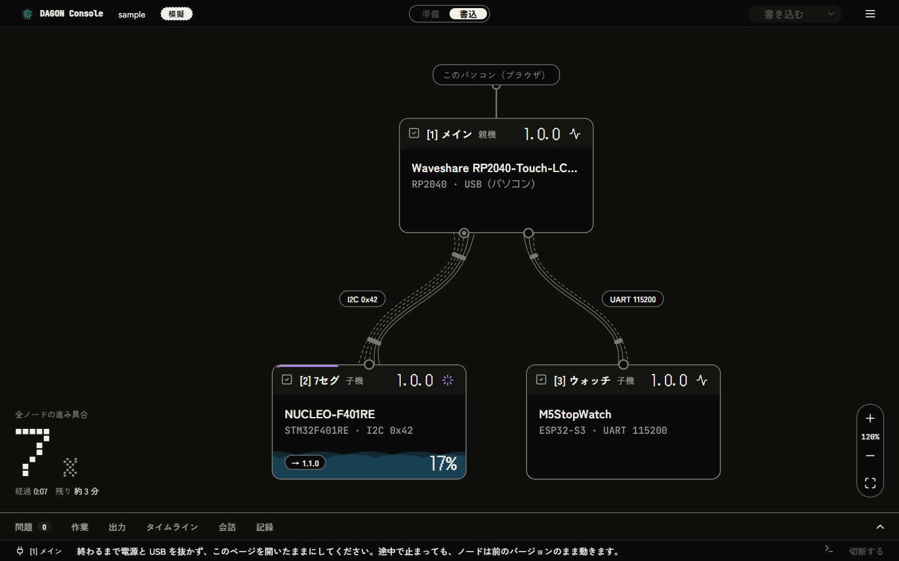
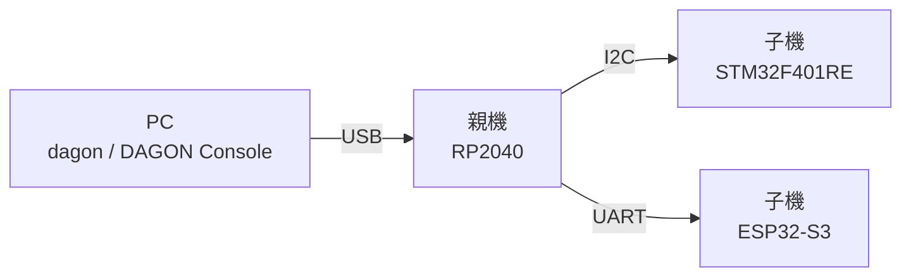

<p align="center">
  <picture>
    <source media="(prefers-color-scheme: dark)" srcset="assets/product-symbol/lockup-horizontal-dark-2400w.png">
    
  </picture>
</p>

<p align="center"><b>プロの分散マイコン設計を、もっと多くの人の手に。マイコンが増えても、書き込みは 1 つのときと同じ操作で、安全に。</b></p>

<p align="center">
  <a href="https://c-ardinal.github.io/DAGON-Boot/demo/">デモを試す</a> ·
  <a href="https://c-ardinal.github.io/DAGON-Boot/doc/">ドキュメント</a> ·
  <a href="README.en.md">English</a> ·
  ライセンス: MIT または Apache-2.0
</p>

> [!IMPORTANT]
> 2026/11/8現在、"Built with Claude: Japan 2026"向けに3種類のマイコンだけがサポートされているα版の状態です。正式リリースまでに破壊的変更が行われるリスクが有ることをご理解下さい。



## DAGON とは

設計は美しいのに、運用が泥くさい。マイコンに仕事を分けて小さくまとめたものでも、プログラムを直すたびに分解し、ケーブルをつなぎ替え、マイコンごとに別の書き込みツールを使うことになります。書き込みが大変すぎるからと、設計のほうを妥協することもあります。

DAGON は、プロや専門家が使う分散マイコンの設計を、AI と電子工作を始める人から、小ささや仕上がりにこだわる個人の開発者まで、幅広い人が扱えるようにします。

組み立てる前に、ノードごとに 1 度だけ直接書き込みます。その後は、書き込み用のパターンに触れることも、ケースを開けることもありません。USB で PC につないだ 1 つのマイコン（親機）を通して、その先のマイコン（子機）にも、1 つのときと同じ操作で書き込めます。ノードが増えて伸びるのは時間で、操作は増えません。

書き込みは安全です。イメージはすべて署名付きで、ノードは新しいバージョンを試しに起動し、うまく動かなければ自分で前のバージョンに戻ります。書き込みが途中で止まっても、動いているバージョンはそのまま残ります。

DAGON の違いは、種類の違うマイコンが混ざっていても、構成を描くだけで扱えることです。開発者は、ボードを選び、つなぎ方を描き、アプリを書きます。起動のしくみ、フラッシュの配置、署名、書き込みの手順は DAGON が受け持ちます。

## ドキュメント

- [はじめに](https://c-ardinal.github.io/DAGON-Boot/doc/getting-started/): 試す、入れる、はじめから書き込みまで
- [やり方](https://c-ardinal.github.io/DAGON-Boot/doc/how-to/): 自分のボード、つながりの差し替え、AI の手助け
- [しくみ](https://c-ardinal.github.io/DAGON-Boot/doc/explanation/): 言葉の意味、イベントと拡張、バージョンの決まり
- [リファレンス](https://c-ardinal.github.io/DAGON-Boot/doc/reference/): コマンド、HTTP API、イベント、定義の形式、Rust API

## できること

- **構成を描く**: ブラウザで動く DAGON Console で、ノードとそのつながりをグラフに描きます。編集のたびに配線やピンの問題を確かめます。
- **ビルドできるプロジェクトを作る**: `dagon new` と `dagon gen` が、ノードごとに起動処理と配線と、自分のコードを書く空の `app.rs` を持つ Rust の crate を作ります。
- **まとめて書き込む**: `dagon deploy` は、ビルド、署名、パッケージ作成、書き込みまでを 1 回で行います。Console では、ノードごとの進み具合を見ながら書き込めます。
- **失敗しても戻る**: イメージはすべて署名付きです。ノードは新しいバージョンを試しに起動し、確定できなければ前のバージョンに戻ります。`dagon rollback` で手でも戻せます。
- **ブートローダにも書き込む**: ブートローダ自体も 2 つのスロットに置き、アプリと同じように書き込みます（RP2040、STM32F401）。新しいものが動かなければ前のものに戻ります。
- **拡張する**: DAGON のソースを変えずに、イベントを受け取る、判断に答える、部品（ポート）を置き換える拡張を足せます。
- **AI に頼る**: 新しいプロジェクトには Claude Code 用の指示とスキルが入っています。`dagon ai link` で、同意のうえエージェントとつなげます。API キーは OS の資格情報ストアに保管します。

どの操作も `dagon` コマンドでできます。

## 対応しているハードウェア

| マイコン | 定義のあるボード |
|---|---|
| RP2040 | Waveshare RP2040-Touch-LCD-1.28 |
| STM32F401RE | NUCLEO-F401RE |
| ESP32-S3 | M5StopWatch |

親機にできるのは RP2040 です。ほかのボードもマイコンを選べば使えます（[自分のボード](https://c-ardinal.github.io/DAGON-Boot/doc/how-to/own-board/)）。詳しい一覧は[ボードとマイコン](https://c-ardinal.github.io/DAGON-Boot/doc/reference/boards/)にあります。

## まず試す

ブラウザだけで、[DAGON Console のデモ](https://c-ardinal.github.io/DAGON-Boot/demo/)を試せます。インストールも実機も要りません。模擬の親機と子機を相手に、書き込みと前のバージョンへの戻し方を操作できます。ファイルの読み書き、機器との接続、API キーの操作はデモでは使えません。

手元の PC でも、実機なしで試せます。

```sh
cargo install --git https://github.com/c-ardinal/DAGON-Boot --tag cli-v0.1.0 dagon-cli
dagon demo
```

`dagon demo` は表示したアドレスで Console を開きます。`dagon sim run` はシミュレータ上で通しのシナリオを実行します。

## 必要なもの

- [Rust](https://rustup.rs): アプリは Rust だけで書きます（ソースからビルドするときは C コンパイラも）
- 実機につなぐときは Chrome か Edge 89 以降（Web Serial を使います）
- マイコンごとのツールは `dagon doctor` が確かめます（[一覧](https://c-ardinal.github.io/DAGON-Boot/doc/reference/tools/)）

ビルド済みのファイルからの入れ方は[入れる](https://c-ardinal.github.io/DAGON-Boot/doc/getting-started/install/)にあります。

## 自分のプロジェクトを始める

```sh
dagon new my-fleet
cd my-fleet
dagon doctor
dagon serve
```

`dagon new` は `dagon.toml` と構成のファイル（見本の 3 ノード）、署名の鍵を作ります。秘密鍵はプロジェクトの外に置かれます。`dagon serve` が表示するアドレスを開くと Console で続けられます。ビルドから最初の書き込みまでは[はじめから書き込みまで](https://c-ardinal.github.io/DAGON-Boot/doc/getting-started/first-project/)を見てください。

既にあるファームウェアに組み込むこともできます（[手順](https://c-ardinal.github.io/DAGON-Boot/doc/how-to/existing-firmware/)）。

## しくみ

次の図は DAGON が目指すソフトウェアの設計です。今のバージョンがどこまで実装しているかは示していません。


| やりたいこと | 触る場所 | 手順 |
|---|---|---|
| アプリを書く | `targets/mcu/*/template/src/app.rs` がノードの `src/app.rs` になります | [はじめから書き込みまで](https://c-ardinal.github.io/DAGON-Boot/doc/getting-started/first-project/) |
| 拡張を足す | `targets/boot-extension-template/`、`crates/dagon-events/src/ports.rs` | [拡張のマニフェスト](https://c-ardinal.github.io/DAGON-Boot/doc/reference/extension-manifest/) |
| ボードを足す | `targets/boards/*/dagon-board.toml` | [自分のボード](https://c-ardinal.github.io/DAGON-Boot/doc/how-to/own-board/) |
| マイコンを足す | `targets/mcu/*/dagon-mcu.toml`、`crates/dagon-port/src/lib.rs` | [マイコンとリンクを足す](https://c-ardinal.github.io/DAGON-Boot/doc/how-to/new-mcu-or-link/) |
| リンクや転送を足す | `crates/dagon-format/src/link.rs`、`targets/mcu/*/src/links.rs`、`crates/dagon-host/src/lib.rs` | [マイコンとリンクを足す](https://c-ardinal.github.io/DAGON-Boot/doc/how-to/new-mcu-or-link/) |
| エージェントを足す | `crates/dagon-cli/agents/`、`~/.dagon/agents/*.toml` | [エージェント定義の形式](https://c-ardinal.github.io/DAGON-Boot/doc/reference/agent-definition/) |



1. PC が署名付きのパッケージの署名と構成を確かめ、親機へ送ります。
2. 親機が子機へ中継します。子機から順に書き込み、親機は最後です。
3. ノードは新しいイメージを動いているものの隣に書き、試しに起動します。
4. 自己確認が通れば確定し、通らなければウォッチドッグのリセットで前のバージョンに戻ります。

DAGON がしないことは[制限事項](https://c-ardinal.github.io/DAGON-Boot/doc/explanation/limitations/)にあります。

## 依存しているものと外部のデータ

- 自作の範囲: `crates/`、`targets/`（下のベンダー部品を除く）、`web/`、`site/`、`samples/`、`plugin/`、`topology/`、`scripts/`
- 依存ライブラリ: Rust の crate と npm パッケージを改変せずに使っています（embassy、esp-hal、ed25519-compact、Svelte、Vite、Astro など）
- ベンダー部品: ESP-IDF の 2nd stage、`rp2040-boot2`、STM32F401 の ROM ブートローダ
- 書体とアイコン: Doto、DotGothic16、Zen Kaku Gothic New、JetBrains Mono（SIL OFL 1.1）、Lucide（ISC）
- マイコンとボードの定義の値: 各社のデータシートとボードの資料から取っています。出典を確かめていない値は、定義の中で `unverified` と示します

全部の一覧とライセンスは[ライセンス](https://c-ardinal.github.io/DAGON-Boot/doc/reference/licenses/)にあります。
