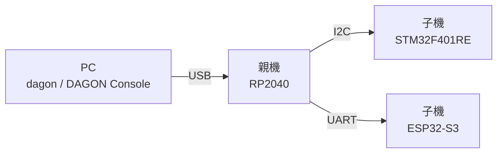
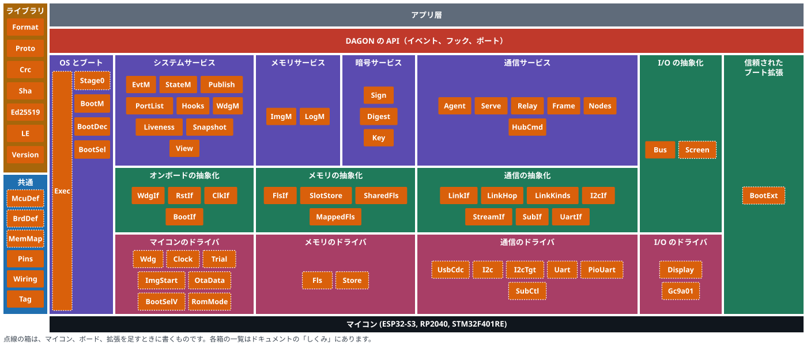

<p align="center">
  <picture>
    <source media="(prefers-color-scheme: dark)" srcset="assets/product-symbol/lockup-horizontal-dark-2400w.png">
    
  </picture>
</p>

<p align="center"><b>プロの分散マイコン設計を、もっと多くの人の手に。マイコンが増えても、書き込みの手間を増やさず、安全に。</b></p>

<p align="center">
  <a href="https://c-ardinal.github.io/DAGON-Boot/demo/">デモを試す</a> ·
  <a href="https://c-ardinal.github.io/DAGON-Boot/doc/">開発用ドキュメント</a> ·
  <a href="README.en.md">English Readme</a> ·
  ライセンス: MIT または Apache-2.0
</p>

> [!IMPORTANT]
> 2026/11/8現在、"Built with Claude: Japan 2026"向けに3種類のマイコンだけがサポートされているα版の状態です。
> 正式リリースまでに破壊的変更が行われるリスクが有ることをご理解下さい。

## DAGONとは

設計は美しいのに、運用が泥くさい。

分散されたマイコンごとに最適な役割を与え、各マイコンが協調して素晴らしい働きをするプロダクトでも、プログラムを直すために分解してケーブルをつなぎ替えたり、マイコンごとに異なる書き込みツールを使うことに苦労することがあります。これを解決するためにプログラムを直すための独自の仕組みを構築したり、運用が大変すぎるからと設計のほうを妥協することもあります。

DAGONはプロや専門家が使う分散マイコンの設計を、AIと電子工作を始める人から設計に妥協しない個人の開発者まで、幅広い人が扱えるようにします。

マイコンごとに最初の1度だけは1台ずつ直接繋いでファクトリーイメージを書き込みます。その後は、1か所つなぐだけで、1台ずつ直接繋ぐ必要はありません。
PCに繋いだ1つのマイコンを通してその先のマイコンにも、たった1つの操作で書き込めます。マイコンが増えて伸びるのは時間で、操作は増えません。

更新用イメージはすべて署名付きで安全に書き込みます。新しいバージョンを試しに起動し、うまく動かなければ自律的に前のバージョンに戻ります。書き込みが途中で止まっても、動いているバージョンはそのまま残ります。

種類の違うマイコンが混ざっていても、構成を描くだけで、DAGONが扱えます。開発者はボードを選び、つなぎ方を描き、アプリを書きます。起動のしくみ、フラッシュの配置、署名、書き込みの手順はDAGONが受け持ちます。

## ドキュメント

- [はじめに](https://c-ardinal.github.io/DAGON-Boot/doc/getting-started/): 試す、入れる、はじめから書き込みまで
- [やり方](https://c-ardinal.github.io/DAGON-Boot/doc/how-to/): 自分のボード、つながりの差し替え、AIの手助け
- [しくみ](https://c-ardinal.github.io/DAGON-Boot/doc/explanation/): 言葉の意味、イベントと拡張、バージョンの決まり
- [リファレンス](https://c-ardinal.github.io/DAGON-Boot/doc/reference/): コマンド、HTTP API、イベント、定義の形式、Rust API

## できること

- **構成を描く**: ブラウザで動くDAGON Consoleで、マイコンとそのつながりをグラフに描きます。編集のたびに配線やピンの問題を確かめます。
- **ビルドできるプロジェクトを作る**: `dagon new`と`dagon gen`が、マイコンごとに起動処理と配線と、自分のコードを書く空の`app.rs`を持つRustのcrateを作ります。
- **まとめて書き込む**: `dagon deploy`は、ビルド・署名・パッケージ作成・書き込みまでを一気通貫で行います。DAGON Console上では、マイコンごとの進み具合をグラフィカルに確認しながら書き込めます。
- **失敗しても戻る**: イメージはすべて署名付きです。マイコンは新しいバージョンを試しに起動し、確定できなければ前のバージョンに戻ります。`dagon rollback`で手でも戻せます。
- **ブートローダにも書き込む**: ブートローダ自体も2つのスロットに置き、アプリと同じように書き込みます。新しいものが動かなければ前のものに戻ります。
- **DAGONを拡張する**: DAGONのソースを変えずに、イベントを受け取る、判断に答える、部品（ポート）を置き換える拡張を足せます。
- **AIの力を借りる**: 新しいプロジェクトにはClaude Code用の指示とスキルが入っています。`dagon ai link`で、同意のうえエージェントとつなげます。APIキーはOSの資格情報ストアに保管します。

どの操作も`dagon`コマンドでできます。

## 対応ハードウェア

| マイコン    | ボード                          |
| ----------- | ------------------------------- |
| RP2040      | Waveshare RP2040-Touch-LCD-1.28 |
| STM32F401RE | NUCLEO-F401RE                   |
| ESP32-S3    | M5StopWatch                     |

## 必要なもの

DAGONを動かすために必要なものです。

- Chrome か Edge 89 以降
- `dagon` コマンド: ビルド済みのファイルなら、ほかに要りません
  - `cargo install` で入れるなら、Rust 1.95.0 以降と C コンパイラ（Windows は Visual Studio 2022 の C++ ビルドツール、Linux は gcc 13 以降、macOS は Xcode Command Line Tools 16.4 以降）

`dagon`コマンドの入れ方は[入れる](https://c-ardinal.github.io/DAGON-Boot/doc/getting-started/install/)にあります。

## まず試す

インストールも実機も不要で[DAGON Consoleのデモ](https://c-ardinal.github.io/DAGON-Boot/demo/)を試せます。模擬の親機と子機を相手に、書き込みと前のバージョンへの戻し方を体験できます。ファイルの読み書き、実際の機器との接続、AI連携操作はデモでは使えません。

手元のPCでも、シミュレータを用いて実機なしで試せます。

1. [GitHub Releases](https://github.com/c-ardinal/DAGON-Boot/releases)から、自分のシステム用のファイルを取ります。
2. `dagon`をPATHの通った場所に置きます。
3. `dagon demo`を実行します。

`dagon demo`は表示したアドレスでDAGON Consoleを開きます。`dagon sim run`はシミュレータ上で通しのシナリオを実行します。

## 自分のプロジェクトを始める

```sh
dagon new my-fleet
cd my-fleet
dagon doctor
dagon serve
```

`dagon new`は`dagon.toml`、構成のファイル、署名の鍵を作ります。構成のファイルには、見本として3つのマイコンの構成が入ります。秘密鍵はプロジェクトの外に置かれます。

アプリは[Rust](https://rustup.rs)だけで書きます。

`dagon doctor`はマイコンごとに必要なツール（[一覧](https://c-ardinal.github.io/DAGON-Boot/doc/reference/tools/)）を確かめ、`dagon doctor --fix`は管理者の権限が要らないものを入れます。

`dagon serve`が表示するアドレスを開くと、DAGON Consoleで続けられます。

ビルドから最初の書き込みまでは[はじめから書き込みまで](https://c-ardinal.github.io/DAGON-Boot/doc/getting-started/first-project/)を見てください。

既にあるファームウェアにDAGONを組み込むこともできます（[手順](https://c-ardinal.github.io/DAGON-Boot/doc/how-to/existing-firmware/)）。

## 書き込みのしくみ

PCにUSBでつないだマイコンを親機と呼びます。親機の先にあるマイコンを子機と呼びます。

次の図は見本の構成です。



1. PCがパッケージの署名を確かめ、パッケージがこの構成に合うことを確かめます。
2. PCが構成を親機へ送ります。
3. PCが親機を通して、マイコンごとに新しいイメージを送ります。子機が先で、親機は最後です。
4. マイコンは、動いているイメージとは別の場所に新しいイメージを書き込みます。
5. マイコンは新しいイメージを試しに起動します。
6. 自己確認が通れば、新しいバージョンに確定します。通らなければ、リセットして前のバージョンに戻ります。

DAGONがしないことは[制限事項](https://c-ardinal.github.io/DAGON-Boot/doc/explanation/limitations/)にあります。

## DAGONの設計

次の図は DAGON のソフトウェアの設計です。



## 変更する場所

### DAGONを使うとき

| やりたいこと       | 触る場所                                                               | 手順                                                                                                |
| ------------------ | ---------------------------------------------------------------------- | --------------------------------------------------------------------------------------------------- |
| アプリを書く       | `nodes/<id>/src/app.rs`                                                | [はじめから書き込みまで](https://c-ardinal.github.io/DAGON-Boot/doc/getting-started/first-project/) |
| 拡張を足す         | `targets/boot-extension-template/`、`crates/dagon-events/src/ports.rs` | [拡張のマニフェスト](https://c-ardinal.github.io/DAGON-Boot/doc/reference/extension-manifest/)      |
| ボードを足す       | `targets/boards/*/dagon-board.toml`                                    | [自分のボード](https://c-ardinal.github.io/DAGON-Boot/doc/how-to/own-board/)                        |
| エージェントを足す | `crates/dagon-cli/agents/`、`~/.dagon/agents/*.toml`                   | [エージェント定義の形式](https://c-ardinal.github.io/DAGON-Boot/doc/reference/agent-definition/)    |

### DAGONそのものに足すとき

| やりたいこと       | 触る場所                                                                                        | 手順                                                                                         |
| ------------------ | ----------------------------------------------------------------------------------------------- | -------------------------------------------------------------------------------------------- |
| マイコンを足す     | `targets/mcu/*/dagon-mcu.toml`、`crates/dagon-port/src/lib.rs`                                  | [マイコンとリンクを足す](https://c-ardinal.github.io/DAGON-Boot/doc/how-to/new-mcu-or-link/) |
| リンクや転送を足す | `crates/dagon-format/src/link.rs`、`targets/mcu/*/src/links.rs`、`crates/dagon-host/src/lib.rs` | [マイコンとリンクを足す](https://c-ardinal.github.io/DAGON-Boot/doc/how-to/new-mcu-or-link/) |

## 依存しているものと外部のデータ

- 自作の範囲: `crates/`、`targets/`（下のベンダー部品を除く）、`web/`、`site/`、`samples/`、`plugin/`、`topology/`、`scripts/`
- 依存ライブラリ: Rustとnpmのライブラリを改変せずに使っています（embassy、esp-hal、ed25519-compact、Svelte、Vite、Astroなど）。
- ベンダー部品: ESP-IDFの2nd stage、`rp2040-boot2`、STM32F401のROMブートローダ
- 書体とアイコン: Doto、DotGothic16、Zen Kaku Gothic New、JetBrains Mono（SIL OFL 1.1）、Lucide（ISC）
- マイコンとボードの定義の値: 各社のデータシートとボードの資料から取っています。出典を確かめていない値は、定義の中で`unverified`と示します。

全部の一覧とライセンスは[ライセンス](https://c-ardinal.github.io/DAGON-Boot/doc/reference/licenses/)にあります。
