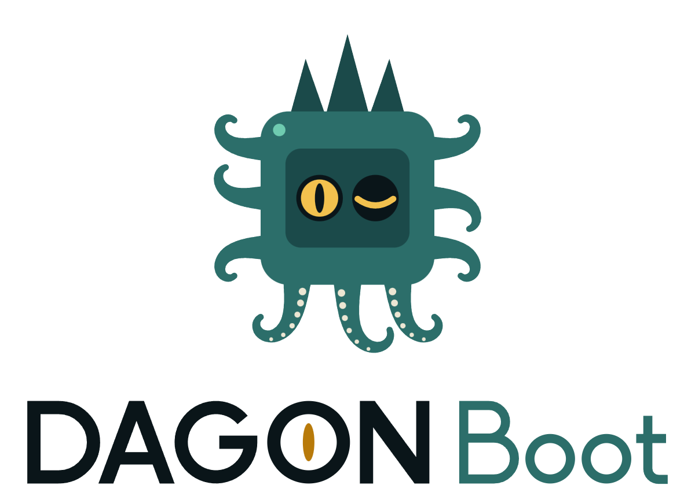
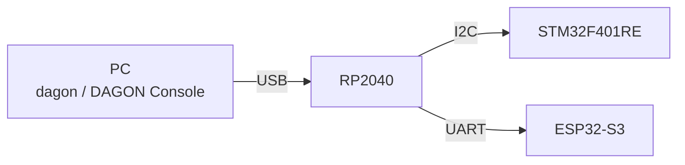
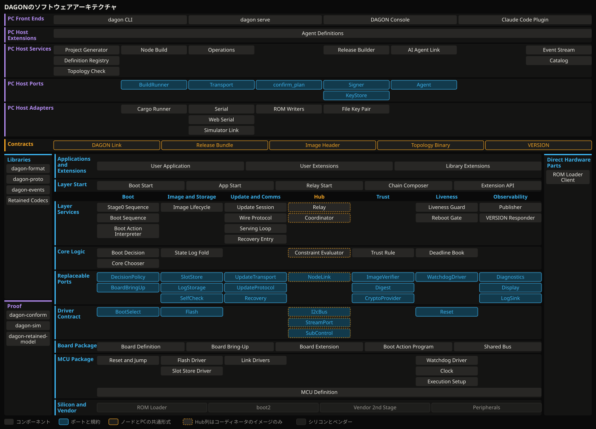

<p align="center">
  <picture>
    <source media="(prefers-color-scheme: dark)" srcset="assets/product-symbol/lockup-vertical-dark-1200w.png">
    
  </picture>
</p>

<p align="center"><b>プロの分散マイコン設計を、より多数のユーザーへ提供します。マイコン数が増加しても、書込の操作数は増加せず、安全です。</b></p>

<p align="center">
  <a href="https://c-ardinal.github.io/DAGON-Boot/demo/">デモ体験</a> ·
  <a href="https://c-ardinal.github.io/DAGON-Boot/doc/">開発用ドキュメント</a> ·
  <a href="README.en.md">English Readme</a> ·
  ライセンス: MITまたはApache-2.0
</p>

> [!IMPORTANT]
> 2026/11/8現在、"Built with Claude: Japan 2026"向けに3種類のマイコンだけがサポートされているα版の状態です。
> 正式リリースまでに破壊的変更が行われるリスクが有ることをご理解下さい。

## DAGONとは

設計は美麗なのに、運用は煩雑です。

[](https://www.youtube.com/watch?v=9SH4c6mgJNY)

分散した各マイコンに最適な役割を付与し、各マイコンの協調で高度な機能を実現するプロダクトでも、プログラム修正の都度、分解してケーブルを再接続したり、マイコン別に異なる書込ツールを使用したりする苦労が発生します。この解決策として、プログラム修正用の独自機構を構築したり、運用の負担が過大なため設計側で妥協したりする場合もあります。

DAGONは、プロや専門家が採用する分散マイコンの設計を、AIを活用して電子工作を開始する層から設計に妥協しない個人開発者まで、広範なユーザーへ開放します。

各マイコンには、初回の1度だけ、1台ずつ直接接続してファクトリーイメージの書込を実行します。以後は1か所の接続のみで、1台ずつの直接接続は不要です。
PCに接続した1つのマイコンを経由して、その接続先のマイコンにも、単一の操作で書込が可能です。マイコン数の増加で増加するのは所要時間のみで、操作は増加しません。

更新用イメージは全件が署名付きで、書込は安全です。マイコンは新バージョンを試験起動し、正常に動作しない場合、旧バージョンのスロットが存在すれば、自律的にそのバージョンへ復帰します。書込が途中で中断しても、スロットが2つのイメージは稼働中のバージョンが無変更で残存し、スロットが1つのイメージは、そのイメージの書込を担当するイメージが残存して、再受信が可能です。イメージの種類別のスロット数（1つまたは2つ）は、マイコンの定義で決定します。

異種のマイコンが混在していても、構成の作図だけで、DAGONが管理可能です。開発者はボードを選択し、接続を作図し、アプリを実装します。起動の機構、フラッシュの配置、署名、書込の手順はDAGONが担当します。

## ドキュメント

- [入門](https://c-ardinal.github.io/DAGON-Boot/doc/getting-started/): 体験、インストール、初回の書込まで
- [ハウツー](https://c-ardinal.github.io/DAGON-Boot/doc/how-to/): 独自ボード、リンクの交換、AIの支援
- [解説](https://c-ardinal.github.io/DAGON-Boot/doc/explanation/): 用語の定義、イベントと拡張、バージョンの規則
- [リファレンス](https://c-ardinal.github.io/DAGON-Boot/doc/reference/): コマンド、HTTP API、イベント、定義の形式、Rust API

## 機能

- **構成の作図**: ブラウザで動作するDAGON Consoleで、マイコンとその接続をグラフとして作図します。編集の都度、配線やピンの問題を検査します。
- **ビルド可能なプロジェクトの生成**: `dagon new`と`dagon gen`が、起動処理、配線、独自コードの記述用の空ファイル`app.rs`で構成するRustのcrateを、マイコン別に生成します。
- **一括書込**: `dagon deploy`は、ビルド・署名・パッケージ作成・書込までを一気通貫で実行します。DAGON Console上では、書込と同時に、マイコン別の進捗をグラフィカルに確認可能です。
- **失敗時の復帰**: イメージは全件が署名付きです。マイコンは新バージョンを試験起動し、確定不可の場合、スロットが2つのイメージは旧バージョンに復帰します。`dagon rollback`による手動の復帰も可能です。
- **ブートローダの書込**: ブートローダ自体もスロットに配置し、アプリと同様に書込を実行します。スロットが2つなら、新ブートローダが動作しない場合に旧ブートローダへ復帰します。1つなら、確定したアプリが起動して、ブートローダの再書込を実行します。
- **DAGONの拡張**: DAGONのソースを変更せずに、イベントの受信、判断への応答、部品（ポート）の置換を担当する拡張を追加可能です。
- **AIの活用**: 新規プロジェクトにはClaude Code用の指示とスキルが同梱されています。`dagon ai link`で、同意の後にエージェントと接続可能です。APIキーはOSの資格情報ストアに保管します。

全操作が`dagon`コマンドで実行可能です。

## 対応ハードウェア

| マイコン    | ボード                          |
| ----------- | ------------------------------- |
| RP2040      | Waveshare RP2040-Touch-LCD-1.28 |
| STM32F401RE | NUCLEO-F401RE                   |
| ESP32-S3    | M5StopWatch                     |

## 体験

### インストール不要の体験

インストールも実機も不要で、ブラウザ(ChromeかEdge 89以降)で[DAGON Consoleのデモ](https://c-ardinal.github.io/DAGON-Boot/demo/)を体験可能です。模擬のマイコン3台（PCに接続した1台と、その接続先の2台）を対象に、書込と旧バージョンへの復帰手順を体験可能です。ファイルの入出力、実機との接続、AI連携の操作はデモでは使用不可です。

### インストール後の体験

ローカルのPCでも、シミュレータを使用して、実機なしで体験可能です。

#### インストール

Linux / macOS

```sh
curl -fsSL https://raw.githubusercontent.com/c-ardinal/DAGON-Boot/main/setup.sh | sh
```

Windows

```powershell
irm https://raw.githubusercontent.com/c-ardinal/DAGON-Boot/main/setup.ps1 | iex
```

#### アンインストール

同一のスクリプトでアンインストール可能です。`~/.dagon`のキーは残存します。キーを削除すると、そのキーで署名したイメージを書込済のマイコンには、以後の書込が不可能になります。

```sh
curl -fsSL https://raw.githubusercontent.com/c-ardinal/DAGON-Boot/main/setup.sh | sh -s -- --uninstall
```

```powershell
$env:DAGON_UNINSTALL = "1"; irm https://raw.githubusercontent.com/c-ardinal/DAGON-Boot/main/setup.ps1 | iex
```

環境変数`DAGON_UNINSTALL=1`でも同様です。PowerShellのスクリプトは、実行後にこの変数を削除します。

#### シミュレータでの体験

```sh
dagon sim # シミュレータ上で一連のシナリオを実行します
```

## 独自プロジェクトの開始

```sh
dagon new my-fleet  # プロジェクトに必要なファイル一式を生成
cd my-fleet
dagon serve         # DAGON Consoleを起動。ブラウザ上で構成を作図
dagon doctor        # 構成に準拠したビルドが可能な状態か検査
```

`dagon doctor`は、その構成のマイコンに必要なツール（[一覧](https://c-ardinal.github.io/DAGON-Boot/doc/reference/tools/)）を確認し、`dagon doctor --fix`の実行で、管理者権限が不要なツールを自動で導入します。

ビルドから初回の書込までは[初回の書込まで](https://c-ardinal.github.io/DAGON-Boot/doc/getting-started/first-project/)を参照してください。

既存のファームウェアへのDAGONの組込も可能です（[手順](https://c-ardinal.github.io/DAGON-Boot/doc/how-to/existing-firmware/)）。

## 書込の機構

PCにはUSBで1台のマイコンを接続します。他のマイコンへの書込は、このマイコンを経由します。

以下の図はサンプルの構成です。



1. PCがパッケージの署名を検証し、パッケージとこの構成の整合を確認します。
2. PCは、USB接続したマイコンを経由して、各マイコンへ新イメージを送信します。順序は接続先のマイコンが先行で、USB接続したマイコンが最後です。
3. マイコンは、稼働中のスロットとは別のスロットへ新イメージの書込を実行します。
4. マイコンは新イメージを試験起動します。
5. PCが確定要求（CONFIRM）を送信し、マイコンは自己確認（`self_check`）が正常なら新規バージョンに確定します。確定しないイメージはリセットされ、スロットが2つなら旧バージョンに復帰します。

各段階はイベントとして拡張に通知され、拡張は判断点（書込の受入、リブートの時期、自己確認）に応答します。PCの代替としてマイコン自身が確定する設定（`Confirm::Own`）も選択可能です。

DAGONの設計上の対象外事項、利用者の責任範囲、設計と実装の差異は[制限事項](https://c-ardinal.github.io/DAGON-Boot/doc/explanation/limitations/)に記載しています。

## DAGONの設計情報

### ソフトウェアアーキテクチャ



### DAGONを使用する場合の参照情報

| 目的               | 編集対象                                                             | 手順                                                                                        |
| ------------------ | -------------------------------------------------------------------- | ------------------------------------------------------------------------------------------- |
| アプリの実装       | `nodes/<id>/src/app.rs`                                              | [初回の書込まで](https://c-ardinal.github.io/DAGON-Boot/doc/getting-started/first-project/) |
| 拡張の追加         | `extensions/<id>/dagon-extension.toml`、`dagon.toml`の`[extensions]` | [拡張のマニフェスト](https://c-ardinal.github.io/DAGON-Boot/doc/reference/extension-manifest/)   |
| エージェントの追加 | `~/.dagon/agents/*.toml`                                             | [エージェント定義の形式](https://c-ardinal.github.io/DAGON-Boot/doc/reference/agent-definition/) |

### DAGON自体を変更する場合の参照情報

| 目的               | 編集対象                                                                                        | 手順                                                                                          |
| ------------------ | ----------------------------------------------------------------------------------------------- | --------------------------------------------------------------------------------------------- |
| ボードの追加       | `targets/boards/*/dagon-board.toml`                                                             | [独自ボード](https://c-ardinal.github.io/DAGON-Boot/doc/how-to/own-board/)                    |
| マイコンの追加     | `targets/mcu/<id>/`                                                                             | [マイコンとリンクの追加](https://c-ardinal.github.io/DAGON-Boot/doc/how-to/new-mcu-or-link/) |
| リンクや転送の追加 | `crates/dagon-format/src/link.rs`、`targets/mcu/*/src/links.rs`、`crates/dagon-host/src/lib.rs` | [マイコンとリンクの追加](https://c-ardinal.github.io/DAGON-Boot/doc/how-to/new-mcu-or-link/) |

### ソースからのDAGONビルド

`dagon`コマンドは、上記「インストール」のスクリプトか、[リリース](https://github.com/c-ardinal/DAGON-Boot/releases)のアーカイブで導入します。両者ともDAGON Consoleを内蔵しています。

このリポジトリのクローンからのビルド時の必要環境は以下のとおりです。

- Rust 1.95.0以降
- Cコンパイラ（WindowsはVisual Studio 2022のC++ビルドツール、Linuxはgcc 13以降、macOSはXcode Command Line Tools 16.4以降）
- DAGON Consoleのページ用に、Python 3、Node.jsとnpm、`wasm-pack` 0.15.1

ページを事前にビルドします。未ビルドの場合、`dagon serve`はページのビルド手順を表示するのみです。

```sh
python scripts/page.py build
cargo install --path crates/dagon-cli
```

アンインストールは`cargo uninstall dagon-cli`です。

## 依存関係と外部データ

- 自作の範囲: `crates/`（以下のテストデータを除外）、`targets/`（以下のベンダー部品を除外）、`web/`、`site/`、`samples/`、`plugin/`、`topology/`、`scripts/`
- 依存ライブラリ: Rustとnpmのライブラリを改変せずに使用しています（embassy、esp-hal、ed25519-compact、Svelte、Vite、Astroなど）。
- ベンダー部品: ESP-IDFの2nd stage、`rp2040-boot2`、STM32F401のROMブートローダ
- テストデータ: Project WycheproofのEd25519のテストベクタ（Apache License 2.0、<https://github.com/C2SP/wycheproof>）とRFC 8032のテストベクタ。`crates/dagon-ed25519/tests/vectors/`に出典を付記して、無改変で配置しています。
- 書体とアイコン: Doto、DotGothic16、Zen Kaku Gothic New、JetBrains Mono（SIL OFL 1.1）、Lucide（ISC）
- マイコンとボードの定義値: 各社のデータシートとボードの資料から引用しています。出典が未確認の値は、定義内で`unverified`と明示します。

一覧とライセンスは[ライセンス](https://c-ardinal.github.io/DAGON-Boot/doc/reference/licenses/)に記載しています。
