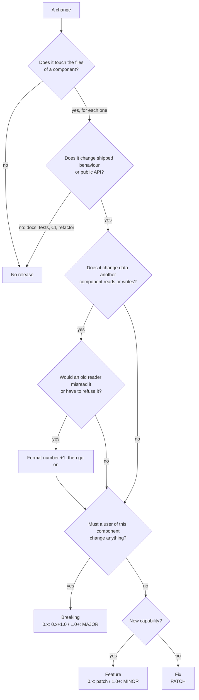

DAGON is made of several components that are released on their own. Each
carries its own [SemVer](https://semver.org/) version, and every
compatibility contract between them (a file format, a protocol, an API)
carries its own integer format number. This page gives the rules for both,
so that anyone looking at the same change reaches the same version.

The list of components and contracts is not kept here. It is
[`compat.toml`](https://github.com/c-ardinal/DAGON-Boot/blob/main/compat.toml), the single source: every component with
its version, files, packages and the format numbers it reads and writes,
and the number each contract is at. The CLI's tests check it against the
code and the package manifests, so it cannot drift.

## Components

A component is something a user installs, flashes or depends on that lives on from release to release.

- Components: the CLI (with the page it serves), a boot loader, an MCU definition, a board definition, a library crate
- Not components: samples (including demo firmware) and test apps. They stay at `0.0.0` with `publish = false`.

A new component starts at `0.1.0`.

### How a component is written in compat.toml

Each `[[component]]` entry has:

| Field | Meaning |
|---|---|
| `name` | The component's name. It is also the commit scope (`feat(<name>):`) and the tag prefix (`<name>-v<version>`) |
| `version` | Its SemVer version |
| `paths` | The files it owns. A file belongs to the component with the longest matching path, so a boot loader inside an MCU definition's folder is its own component. A file outside every component (README, `scripts/`, `.github/`, samples) never needs a release |
| `packages` | The Cargo packages that carry this version in their own `Cargo.toml`; a component made of several packages gives them all the same version. There is no version shared through the workspace |
| `formats` | For each contract it uses, the format numbers it reads and writes |

The CLI's entry also stands for the page it serves: `web/package.json`
carries the same version.

### Adding a component

1. Add its `[[component]]` entry to `compat.toml` with version `0.1.0`.
2. Set `version = "0.1.0"` in each of its packages.
3. Run the CLI's tests (`cargo test -p dagon-cli versions`). They fail when
   a package's version differs from its entry, when a listed path does not
   exist, or when a package outside every entry is not `0.0.0`.

## Contracts and format numbers

A contract's format number is separate from every product version: a
component can go from 0.1.0 to 0.4.2 while it still writes the same format
number.

`[formats]` in `compat.toml` names every contract and the number it is at
(listed in [Contracts and components](/en/reference/contracts/));
the comment beside each says where the number is written and which code
constant holds it. Every artifact and message of a contract states its
number, and a reader refuses a number it does not read with a message that
names both numbers (for example `release.dgb is bundle format 2; this dagon 0.1.0 reads bundle format 1`).

One contract has a default: MCU and board definition files
(`dagon-mcu.toml`, `dagon-board.toml`) that leave out `format` are read as
format 1, so files users write by hand keep loading. DAGON's own definition
files always state it. Every other contract always carries its number.

### Adding a contract

1. Give the artifact or message a number field, starting at 1, and make
   its readers refuse other numbers.
2. Add the contract to `[formats]` in `compat.toml` and to each component
   that reads or writes it.
3. Add the code constant to the CLI's list of format numbers
   (`crates/dagon-cli/src/versions.rs`); its tests fail while the table and
   the code disagree.

## Image versions

Image versions are not component versions. The version in a signed image
header (given when the image is signed, or the default a first install
uses) is the version of that image on the device, chosen by the project.
It has no relation to the version of the boot loader component that built
it.

## What kind of change is it

Decide for each component whose files the change touches.

**Breaking**: a user of that component must change something.

- The CLI: a command, flag, config key, exit code or machine-readable
  output (JSON, `--version` lines, API fields) removed or changed in
  meaning; or an old format number no longer read.
- A boot loader: an old image or state log format no longer accepted, or a
  device needs its ROM re-provisioned (rewritten through the boot ROM) to
  take the new version.
- An MCU or board definition: its public Rust API, or its definition keys,
  changed incompatibly.
- A library crate: an incompatible public API change, as
  [cargo-semver-checks](https://github.com/obi1kenobi/cargo-semver-checks)
  reports it.

**Feature**: a new capability, and everything that worked keeps working.

**Fix**: behaviour corrected to what the documentation already promises,
with no new capability.

**No release**: documentation, tests, CI, and refactors that change no
shipped behaviour.

When one change is several kinds, the largest one counts.

## From the kind to the version

| Kind | While `0.x.y` | From `1.0.0` |
|---|---|---|
| Breaking | `0.(x+1).0` | `(MAJOR+1).0.0` |
| Feature | `0.x.(y+1)` | `MAJOR.(MINOR+1).0` |
| Fix | `0.x.(y+1)` | `MAJOR.MINOR.(PATCH+1)` |
| No release | unchanged | unchanged |

The `0.x` rule is Cargo's: a change in the left-most non-zero number is
breaking. Only the maintainers declare `1.0.0`.

Several changes between two releases: take the largest kind over all of
them and bump once.

### Dependencies

Only components whose files changed are bumped. When a dependency is
bumped, a component that depends on it is bumped only if its own API or
behaviour changes as a result, and then by the same rules. Otherwise it is
rebuilt against the new dependency and keeps its version until its own
next release.

### Format numbers

- `+1` when a reader of the old number would misread the new data or must
  refuse it.
- A component that starts reading a new number and still reads the old
  one: feature.
- A component that stops reading or writing an old number: breaking.
- A change an old reader handles correctly (for example a field in a
  reserved area that old readers ignore by design) keeps the number.

## Decision flow



The same in words:

1. List the components whose files the change touches. None: no release.
2. For each: no shipped behaviour or public API change: no release for it.
3. If it changes data another component reads or writes and an old reader
   would misread or refuse it, add 1 to that format number.
4. Must a user of the component change anything (including: an old format
   number is no longer read or written)? Breaking.
5. Otherwise, a new capability? Feature. If not, fix.

## Examples

| Change | Result |
|---|---|
| The CLI gains a subcommand | CLI feature |
| A CLI flag is renamed | CLI breaking |
| A JSON output of the CLI gains a field | CLI feature |
| A boot loader fixes a CRC check bug | boot loader fix |
| Image header format N+1, which boot loaders reading only N cannot read | image header format +1; a boot loader that reads N and N+1: feature; the CLI: breaking only when it stops writing N |
| A README typo | no release |
| A board definition adds a definition key the definition reader already accepts | board definition feature |
| A library crate removes a public function | that library breaking (cargo-semver-checks) |
| A refactor inside a library with no API or behaviour change | no release |
| The protocol library adds a command and the CLI starts using it | protocol library feature, CLI feature; components that only rebuild against them keep their versions |

## Commits

Commits follow [Conventional Commits](https://www.conventionalcommits.org/)
with the component's `name` as the scope:

```
feat(<component>): <a new capability>
fix(<component>): <behaviour corrected to what the docs promise>
feat(<component>)!: <a change users must act on>
docs: <no release>
```

- `feat` is a feature, `fix` (and `perf`) a fix; `docs`, `test`, `ci`,
  `refactor`, `chore`, `style`, `build` need no release.
- `!` after the scope, or a `BREAKING CHANGE:` footer, marks a breaking
  change.
- A commit that touches several components names the main one; the bump
  check counts the commit, at its kind, for every component whose files it
  touches. This can ask more of a component than its own change needs;
  split such a commit into one per component to avoid that.

## Releases

- One tag per component release: `<name>-v<version>`, for example
  `<name>-v0.2.0`.
- Pre-releases for maintainer trials: `-rc.N` (`<name>-v0.2.0-rc.1`). The tag
  alone makes one: `compat.toml` and the crates stay at `0.2.0`, so
  `dagon --version` also says `0.2.0`. The release that follows drops the
  suffix and keeps the version.
- Release files carry the component name and the tag's version in their names
  (`dagon-cli-0.2.0-rc.1-<target>.tar.gz`).
- A CLI pre-release is published on GitHub as a pre-release. `install.sh` and
  `install.ps1` do not choose one unless that version (`0.2.0-rc.1`) is named.
  `cargo binstall` looks for the archive of the crate's version, so it does
  not install a pre-release.
- A component's changelog is made from the commits since its last tag that
  touch its files: `python scripts/changelog.py <name> [--from <tag>] [--to <rev>]` prints the section (Breaking, Features, Fixes), reading
  commits exactly as the bump check does.
- `python scripts/bump_check.py <name>` checks that the version in
  `compat.toml` is at least what the commits since the component's last tag
  require. The release workflow (`.github/workflows/release.yml`) runs it
  for every pushed `<name>-v<version>` and `<name>-v<version>-rc.N` tag, taking
  the component from the tag, and fails a tag that names no component or a
  version other than the one in `compat.toml`. The workflow says which
  components then build release files.
- Nothing is pushed, tagged on the remote or published without the
  maintainers' OK.

## Compatibility between components

Two components work together when, for every contract they both use, they
share a format number in their `formats` entries in `compat.toml`.

The CLI shows what it knows: `dagon --version` and `GET /v1/hello` give its
version and every format number it reads and writes; `dagon status` and
`dagon doctor` also list the component versions of the CLI's own release.
For a connected device, the CLI compares the numbers the device reports
with its own entry and warns on a combination the table does not allow.
