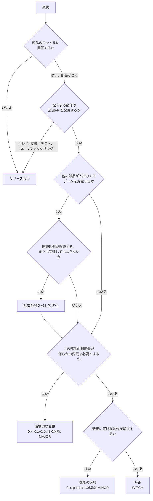

対象読者はDAGON貢献者です。[イメージのバージョン](#イメージのバージョン)の節だけは、アプリ開発者も対象です。

DAGONは、個別にリリースする複数の部品の集合です。各部品は独自の
[SemVer](https://semver.org/)のバージョンを保持し、部品間の互換性の規約（ファイル形式、プロトコル、API）は、それぞれ独自の整数の形式番号を保持します。このページは両方の規則を提示します。同一の変更から、誰でも同一のバージョンに到達可能にするためです。

部品と規約の一覧はこのページには記載しません。一覧の唯一の格納先は
[`compat.toml`](https://github.com/c-ardinal/DAGON-Boot/blob/main/compat.toml)で、全部品のバージョン、ファイル、crate、入出力する形式番号と、規約ごとの最新の番号を記載しています。CLIのテストがコードとcrateのマニフェストに照合して検証するので、不一致は発生しません。

## 部品

部品とは、利用者がインストール、書込、または依存の対象とするもので、複数のリリースにわたり継続するものです。

- 部品であるもの: CLI（配信するページも対象）、ブートローダ、マイコンの定義、ボードの定義、ライブラリのcrate
- 部品でないもの: サンプル（デモのファームウェアも対象）とテスト用のアプリ。これらは`0.0.0`のまま`publish = false`とします。

新規部品は`0.1.0`から開始します。

### compat.tomlでの部品の記述方法

`[[component]]`の項目ごとに、以下の欄があります。

| 欄 | 意味 |
|---|---|
| `name` | 部品の名称。コミットのスコープ（`feat(<name>):`）とタグの接頭辞（`<name>-v<version>`）にも使用します |
| `version` | SemVerのバージョン |
| `paths` | その部品のファイル。ファイルは、一致するパスが最長の部品に属します。そのため、マイコン定義のフォルダ内にあるブートローダは独立した部品です。どの部品にも属さないファイル（README、`scripts/`、`.github/`、サンプル）にはリリースは不要です |
| `packages` | このバージョンを自身の`Cargo.toml`に保持するcrate。複数のcrateで構成する部品は、全crateを同一バージョンにします。ワークスペースで共有するバージョンはありません |
| `formats` | 使用する規約ごとに、入出力する形式番号 |

CLIの項目は配信するページの分も兼ねます。`web/package.json`も同一のバージョンを保持します。

### 部品の追加

1. `compat.toml`に、バージョン`0.1.0`の`[[component]]`の項目を追加します。
2. その部品の各crateに`version = "0.1.0"`を設定します。
3. CLIのテストを実行します（`cargo test -p dagon-cli versions`）。crateのバージョンが項目と相違する場合、一覧のパスが存在しない場合、どの項目にも属さないcrateが`0.0.0`以外の場合に失敗します。

## 規約と形式番号

規約の形式番号は製品のどのバージョンとも独立しています。部品のバージョンが0.1.0から0.4.2に上昇しても同一の形式番号で出力する場合があります。

`compat.toml`の`[formats]`には、全規約と最新の番号を記載しています（一覧は[規約と部品](/reference/contracts/)）。各行のコメントが、番号の記録位置と、番号を保持するコードの定数を明示します。規約の成果物とメッセージは、例外なく自身の番号を明示します。読込側は読込不可能な番号を拒否し、両方の番号を列挙したメッセージを出力します（例: `release.dgb is bundle format 2; this dagon 0.1.0 reads bundle format 1`）。

既定値がある規約が1個あります。マイコンとボードの定義ファイル（`dagon-mcu.toml`、`dagon-board.toml`）は、`format`の省略時に形式1として読込します。利用者が手動で記述したファイルを読込可能にするためです。DAGON自身の定義ファイルには必ず記述します。その他の規約は必ず番号を保持します。

### 規約の追加

1. 成果物またはメッセージに1から開始する番号の欄を設け、読込側がその他の番号を拒否するようにします。
2. `compat.toml`の`[formats]`と、その規約を入出力する各部品に、その規約を追加します。
3. CLIの形式番号の一覧（`crates/dagon-cli/src/versions.rs`）に、コードの定数を追加します。表とコードが不一致の間は、そのテストが失敗します。

## イメージのバージョン

イメージのバージョンは部品のバージョンではありません。署名付きのイメージのヘッダにあるバージョンは、ノード用crateの`Cargo.toml`にある`version`です。初回の書込（`dagon flash`）、ビルド、配信（`dagon deploy`）は同一の値を使用し、既定値はありません。`version`が不在のcrateは拒否します。`dagon deploy --version`の指定値は、crateの`version`との一致が必要です。ブートローダのイメージのバージョンは、ブート用crateの`Cargo.toml`にある`version`です。どちらもブートローダ部品のバージョンとは無関係です。

## どの種類の変更か

変更が関係するファイルの部品ごとに決定します。

**破壊的な変更**: その部品の利用者に何らかの変更を要求する変更です。

- CLI: コマンド、フラグ、設定のキー、終了コード、機械可読の出力（JSON、`--version`の行、APIの欄）の削除、または意味の変更。または、旧形式番号の読込の廃止。
- ブートローダ: 旧イメージや旧状態ログ形式の受理の廃止。または、新版の受信のために、デバイスのROMからの再準備（ブートROM経由の再書込）が必要になる変更。
- マイコンやボードの定義: 公開のRust APIや定義のキーの、互換性のない変更。
- ライブラリのcrate: [cargo-semver-checks](https://github.com/obi1kenobi/cargo-semver-checks)が報告する、互換性のない公開APIの変更。

**機能の追加**: 新規に可能な動作が増加し、既存の動作は例外なく継続する変更です。

**修正**: 動作を文書で約束済の内容に修正する変更です。新規に可能な動作は増加しません。

**リリースなし**: 文書、テスト、CI、配布する動作を変更しないリファクタリング。

1個の変更が複数の種類に該当する場合は、最大の種類を使用します。

## 種類からバージョンへ

| 種類 | `0.x.y`の間 | `1.0.0`以降 |
|---|---|---|
| 破壊的な変更 | `0.(x+1).0` | `(MAJOR+1).0.0` |
| 機能の追加 | `0.x.(y+1)` | `MAJOR.(MINOR+1).0` |
| 修正 | `0.x.(y+1)` | `MAJOR.MINOR.(PATCH+1)` |
| リリースなし | 変更なし | 変更なし |

`0.x`のルールはCargoの規則です。0以外で最も左にある数字を変更する場合が、破壊的な変更に該当します。`1.0.0`を宣言するのはメンテナだけです。

2個のリリースの間に複数の変更がある場合は、全体で最大の種類を採用し、1回だけ上げます。

### 依存

上げるのは、ファイルが変化した部品だけです。依存先のバージョンが上がっても、依存する部品を上げるのは、その結果として自身のAPIや動作が変化する場合だけで、同一の規則に従います。それ以外の場合は新版の依存先に対してビルドするだけで、自身の次回リリースまでバージョンを変更しません。

### 形式番号

- 旧番号の読込側が新データを誤読する、または受理してはならない場合は`+1`します。
- 部品が新番号の読込を開始し、旧番号の読込も継続する場合は機能の追加です。
- 部品が旧番号の読込または出力を廃止する場合は破壊的な変更です。
- 旧読込側が正常に処理可能な変更（例: 旧読込側が設計上無視する予約領域の欄）では、番号を変更しません。
- 規約が値を運搬するRustの列挙型（判定、重大度）は`#[non_exhaustive]`とします。値の追加はそのcrateの機能の追加で、他のcrateのコードは未知の値の処理を事前に備えます。

## 判断の流れ



同一の内容を文章で記述すると、以下のとおりです。

1. 変更が関係するファイルの部品を列挙します。該当がなければリリースはありません。
2. 各部品について、配布する動作も公開APIも変化しなければ、その部品のリリースはありません。
3. 他の部品が入出力するデータを変更し、旧読込側が誤読する、または受理しないなら、その形式番号に1を加算します。
4. その部品の利用者が何らかの変更を必要とするなら（旧形式番号の読込または出力の廃止も該当）、破壊的な変更です。
5. それ以外で、新規に可能な動作が増加すれば機能の追加、増加しなければ修正です。

## 例

| 変更 | 結果 |
|---|---|
| CLIにサブコマンドを追加 | CLIの機能の追加 |
| CLIのフラグの名称を変更 | CLIの破壊的な変更 |
| CLIのJSON出力に欄を追加 | CLIの機能の追加 |
| ブートローダのCRC検査の不具合を修正 | ブートローダの修正 |
| イメージのヘッダ形式N+1を、Nだけを読込するブートローダは読込不可能 | イメージのヘッダ形式を+1。NとN+1を読込するブートローダは機能の追加。CLIはNの出力を廃止する場合だけ破壊的な変更 |
| READMEの誤字 | リリースなし |
| ボード定義に、読込側が受理済の定義のキーを追加 | ボード定義の機能の追加 |
| ライブラリのcrateが公開の関数を削除 | そのライブラリの破壊的な変更（cargo-semver-checks） |
| APIも動作も変更しない、ライブラリ内のリファクタリング | リリースなし |
| プロトコルライブラリがコマンドを追加し、CLIがそのコマンドの使用を開始 | プロトコルライブラリの機能の追加、CLIの機能の追加。それらに対してビルドするだけの部品は、バージョンを変更しません |

## コミット

コミットは[Conventional Commits](https://www.conventionalcommits.org/)に従い、部品の`name`をスコープにします。

```
feat(<component>): <a new capability>
fix(<component>): <behaviour corrected to what the docs promise>
feat(<component>)!: <a change users must act on>
docs: <no release>
```

- `feat`は機能の追加、`fix`（と`perf`）は修正です。`docs`、`test`、`ci`、`refactor`、`chore`、`style`、`build`にリリースは不要です。
- スコープの後の`!`か、`BREAKING CHANGE:`のフッターが破壊的な変更を明示します。
- 複数の部品に関係するコミットは、主要な部品の名称をスコープにします。バージョンの確認では、そのコミットをその種類として、ファイルが関係する全部品に計上します。そのため、部品自身の変更に必要な水準以上を要求する場合があります。回避するには、コミットを部品ごとに分割してください。

## リリース

- 部品のリリースごとにタグを1個付与します: `<name>-v<version>`（例: `<name>-v0.2.0`）。
- メンテナの試用のためのプレリリースは`-rc.N`です（`<name>-v0.2.0-rc.1`）。タグの付与だけで作成します。`compat.toml`とcrateのバージョンは`0.2.0`のままなので、`dagon --version`も`0.2.0`を表示します。その後のリリースでは接尾辞を除去し、バージョンは変更しません。
- リリースのファイル名には、部品の名称とタグのバージョンを付与します（`dagon-cli-0.2.0-rc.1-<target>.tar.gz`）。
- CLIのプレリリースは、GitHubにプレリリースとして公開します。`setup.sh`と`setup.ps1`は、バージョンの指定がなければプレリリースを選択せず、そのバージョン（`0.2.0-rc.1`）の指定時だけインストールします。`cargo binstall`はcrateのバージョンのアーカイブを探索するので、プレリリースをインストールしません。
- 部品の変更履歴は、その部品の最終タグ以降のコミットのうち、そのファイルに関係するものから作成します: `python scripts/changelog.py <name> [--from <tag>] [--to <rev>]`がその節（Breaking、Features、Fixes）を出力します。コミットの解釈方法はバージョンの確認と完全に同一です。
- `python scripts/bump_check.py <name>`は、`compat.toml`のバージョンが、その部品で最終タグ以降のコミットが要求する水準以上であることを確認します。リリースのワークフロー（`.github/workflows/release.yml`）は、pushされた`<name>-v<version>`と`<name>-v<version>-rc.N`のタグごとにこの確認を実行し、部品をタグから判定します。部品を指定しないタグや、`compat.toml`と異なるバージョンを指定するタグは失敗にします。その後にビルドする部品のリリースファイルは、ワークフローが明示します。
- メンテナの了承なしに、push、リモートへのタグ付与、公開のいずれも実施しません。

## 部品間の互換性

2個の部品が併用可能なのは、両方が使用する全規約について、`compat.toml`の`formats`の項目に共通の形式番号がある場合です。

CLIは自身の対応範囲を明示します。`dagon --version`と`GET /v1/hello`は、自身のバージョンと、入出力する全形式番号を表示します。`dagon status`と`dagon doctor`は、CLI自身のリリースを構成する部品のバージョンも列挙します。接続中のデバイスについては、CLIはデバイスが報告する番号を自身の項目と比較し、表が許可しない組合せには警告を出力します。
