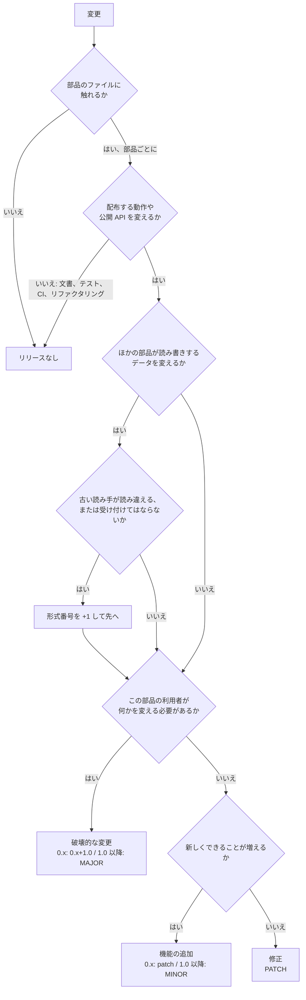

DAGONは別々にリリースするいくつかの部品でできています。部品はそれぞれ自分の
[SemVer](https://semver.org/)のバージョンを持ち、部品のあいだの互換性の取り決め（ファイルの形式、プロトコル、API）は、それぞれ自分の整数の形式番号を持ちます。このページは両方のルールを示します。同じ変更を見れば、だれでも同じバージョンにたどり着けるようにするためです。

部品と取り決めの一覧は、ここには置きません。唯一の置き場所は
[`compat.toml`](https://github.com/c-ardinal/DAGON-Boot/blob/main/compat.toml)で、すべての部品のバージョン、ファイル、crate、読み書きする形式番号と、取り決めごとのいまの番号があります。CLIのテストがコードとcrateのマニフェストに照らして確かめるので、ずれることはありません。

## 部品

部品とは、利用者がインストールする、書き込む、または依存するもので、リリースをまたいで続くものです。

- 部品であるもの: CLI（配信するページを含む）、ブートローダ、マイコンの定義、ボードの定義、ライブラリのcrate
- 部品でないもの: サンプル（デモのファームウェアを含む）とテスト用のアプリ。これらは`0.0.0`のまま`publish = false`とします。

新しい部品は`0.1.0`から始めます。

### compat.tomlでの部品の書き方

`[[component]]`の項目ごとに、次の欄があります。

| 欄 | 意味 |
|---|---|
| `name` | 部品の名前。コミットのスコープ（`feat(<name>):`）とタグの接頭辞（`<name>-v<version>`）にもなります |
| `version` | SemVerのバージョン |
| `paths` | その部品のファイル。ファイルは、一致するパスがいちばん長い部品に属します。そのため、マイコンの定義のフォルダの中にあるブートローダは、独立した部品です。どの部品にも属さないファイル（README、`scripts/`、`.github/`、サンプル）には、リリースは要りません |
| `packages` | このバージョンを自分の`Cargo.toml`に持つcrate。複数のcrateでできた部品は、すべて同じバージョンにします。ワークスペースで共有するバージョンはありません |
| `formats` | 使う取り決めごとに、読み書きする形式番号 |

CLIの項目は配信するページの分も兼ねています。`web/package.json`も同じバージョンを持ちます。

### 部品を足す

1. `compat.toml`に、バージョン`0.1.0`の`[[component]]`の項目を足します。
2. その部品の各crateに`version = "0.1.0"`を設定します。
3. CLIのテストを実行します（`cargo test -p dagon-cli versions`）。crateのバージョンが項目と違うとき、一覧のパスが存在しないとき、どの項目にも属さないcrateが`0.0.0`でないときに失敗します。

## 取り決めと形式番号

取り決めの形式番号は、製品のどのバージョンとも別のものです。部品が0.1.0から0.4.2に進んでも、同じ形式番号のまま書き出すことがあります。

`compat.toml`の`[formats]`には、すべての取り決めといまの番号があります（一覧は[取り決めと部品](/reference/contracts/)）。それぞれの横のコメントが、番号の書かれる場所と、番号を持つコードの定数を示します。取り決めの成果物とメッセージは、どれも自分の番号を示します。読む側は読めない番号を受け付けず、両方の番号を挙げたメッセージを出します（例: `release.dgb is bundle format 2; this dagon 0.1.0 reads bundle format 1`）。

既定の値がある取り決めが1つあります。マイコンとボードの定義ファイル（`dagon-mcu.toml`、`dagon-board.toml`）は、`format`を省くと形式1として読みます。利用者が手で書いたファイルを読み込めるようにするためです。DAGON自身の定義ファイルは必ず書きます。ほかの取り決めは必ず番号を持ちます。

### 取り決めを足す

1. 成果物またはメッセージに、1から始まる番号の欄を持たせ、読む側がほかの番号を受け付けないようにします。
2. `compat.toml`の`[formats]`と、それを読み書きする各部品に、その取り決めを足します。
3. CLIの形式番号の一覧（`crates/dagon-cli/src/versions.rs`）に、コードの定数を足します。表とコードが一致しないあいだは、そのテストが失敗します。

## イメージのバージョン

イメージのバージョンは、部品のバージョンではありません。署名付きのイメージのヘッダにあるバージョン（イメージの署名のときに与えるか、最初のインストールが使う既定の値）は、デバイス上のそのイメージのバージョンで、プロジェクトが決めます。そのイメージをビルドしたブートローダの部品のバージョンとは関係ありません。

## どの種類の変更か

変更が触れるファイルの部品ごとに決めます。

**破壊的な変更**: その部品の利用者が何かを変えなければならないもの。

- CLI: コマンド、フラグ、設定のキー、終了コード、機械が読む出力（JSON、`--version`の行、APIの欄）をなくす、または意味を変える。または、古い形式番号を読まなくなる。
- ブートローダ: 古いイメージや状態ログの形式を受け付けなくなる。または、新しいバージョンを受け取るために、デバイスのROMからの準備のやり直し（ブートROMを通した書き直し）が必要になる。
- マイコンやボードの定義: 公開のRust APIや定義のキーを、互換性のない形で変える。
- ライブラリのcrate: [cargo-semver-checks](https://github.com/obi1kenobi/cargo-semver-checks)が報告する、互換性のない公開APIの変更。

**機能の追加**: 新しくできることが増え、動いていたものはすべて動き続けるもの。

**修正**: 動作を、文書がすでに約束している内容に直すもの。新しくできることは増えません。

**リリースなし**: 文書、テスト、CI、配布する動作を変えないリファクタリング。

1つの変更が複数の種類にあたるときは、いちばん大きいものを使います。

## 種類からバージョンへ

| 種類 | `0.x.y`のあいだ | `1.0.0`から |
|---|---|---|
| 破壊的な変更 | `0.(x+1).0` | `(MAJOR+1).0.0` |
| 機能の追加 | `0.x.(y+1)` | `MAJOR.(MINOR+1).0` |
| 修正 | `0.x.(y+1)` | `MAJOR.MINOR.(PATCH+1)` |
| リリースなし | 変えない | 変えない |

`0.x`のルールはCargoのものです。いちばん左の0でない数字の変更が、破壊的な変更にあたります。`1.0.0`を宣言するのはメンテナだけです。

2つのリリースのあいだに複数の変更があるときは、全体でいちばん大きい種類を取り、1回だけ上げます。

### 依存

上げるのは、ファイルが変わった部品だけです。依存先が上がっても、それに依存する部品を上げるのは、その結果として自分のAPIや動作が変わるときだけで、同じルールに従います。それ以外のときは、新しい依存先に対してビルドするだけで、自分の次のリリースまでバージョンを変えません。

### 形式番号

- 古い番号の読み手が新しいデータを読み違える、または受け付けてはならないときは`+1`します。
- 部品が新しい番号を読み始め、古い番号も読み続けるときは、機能の追加です。
- 部品が古い番号を読まなくなる、または書かなくなるときは、破壊的な変更です。
- 古い読み手が正しく扱える変更（例: 古い読み手が設計上無視する予約領域の欄）では、番号を変えません。

## 判断の流れ



同じことを言葉で書くと、次のとおりです。

1. 変更が触れるファイルの部品を挙げます。無ければ、リリースはありません。
2. それぞれについて、配布する動作も公開APIも変わらなければ、その部品のリリースはありません。
3. ほかの部品が読み書きするデータを変え、古い読み手が読み違える、または受け付けないなら、その形式番号に1を足します。
4. その部品の利用者が何かを変える必要があれば（古い形式番号を読まなくなる、書かなくなる場合を含む）、破壊的な変更です。
5. それ以外で、新しくできることが増えれば機能の追加、増えなければ修正です。

## 例

| 変更 | 結果 |
|---|---|
| CLIにサブコマンドが増える | CLIの機能の追加 |
| CLIのフラグの名前を変える | CLIの破壊的な変更 |
| CLIのJSON出力に欄が増える | CLIの機能の追加 |
| ブートローダのCRC検査の不具合を直す | ブートローダの修正 |
| イメージのヘッダの形式N+1で、Nだけを読むブートローダには読めない | イメージのヘッダの形式を +1。NとN+1を読むブートローダは機能の追加。CLIはNを書かなくなるときだけ破壊的な変更 |
| READMEの誤字 | リリースなし |
| ボードの定義が、定義の読み手がすでに受け付ける定義のキーを足す | ボードの定義の機能の追加 |
| ライブラリのcrateが公開の関数を消す | そのライブラリの破壊的な変更（cargo-semver-checks） |
| APIも動作も変えない、ライブラリの中のリファクタリング | リリースなし |
| プロトコルのライブラリがコマンドを足し、CLIがそれを使い始める | プロトコルのライブラリの機能の追加、CLIの機能の追加。それらに対してビルドするだけの部品は、バージョンを変えません |

## コミット

コミットは[Conventional Commits](https://www.conventionalcommits.org/)に従い、部品の`name`をスコープにします。

```
feat(<component>): <a new capability>
fix(<component>): <behaviour corrected to what the docs promise>
feat(<component>)!: <a change users must act on>
docs: <no release>
```

- `feat`は機能の追加、`fix`（と`perf`）は修正です。`docs`、`test`、`ci`、`refactor`、`chore`、`style`、`build`にリリースは要りません。
- スコープの後の`!`か、`BREAKING CHANGE:`のフッターが破壊的な変更を示します。
- 複数の部品に触れるコミットは、主な部品の名前をスコープにします。バージョンの確認は、そのコミットをその種類で、ファイルに触れたすべての部品に数えます。そのため、部品自身の変更に必要な以上のものを求めることがあります。避けるには、コミットを部品ごとに分けてください。

## リリース

- 部品のリリースごとにタグを1つ付けます: `<name>-v<version>`（例: `<name>-v0.2.0`）。
- メンテナの試用のためのプレリリースは`-rc.N`です（`<name>-v0.2.0-rc.1`）。その次のリリースは、接尾辞を外し、バージョンはそのままです。
- リリースのファイルの名前には、部品の名前とバージョンが入ります。
- 部品の変更履歴はその部品の最後のタグ以降のコミットのうち、そのファイルに触れるものから作ります: `python scripts/changelog.py <name> [--from <tag>] [--to <rev>]`がその節（Breaking、Features、Fixes）を出力します。コミットの読み方はバージョンの確認とまったく同じです。
- `python scripts/bump_check.py <name>`は、`compat.toml`のバージョンが、その部品の最後のタグ以降のコミットが求める以上であることを確かめます。リリースのワークフロー（`.github/workflows/release.yml`）は、pushされた`<name>-v<version>`のタグごとにこれを実行し、部品をタグから取ります。部品を指さないタグや、別のバージョンを指すタグは失敗にします。その後でどの部品のリリースのファイルをビルドするかは、ワークフローが示します。
- メンテナの了承なしに、pushも、リモートへのタグ付けも、公開もしません。

## 部品のあいだの互換性

2つの部品が一緒に動くのは、両方が使うすべての取り決めについて、`compat.toml`の`formats`の項目に共通の形式番号があるときです。

CLIは、自分が知っていることを示します。`dagon --version`と`GET /v1/hello`は、自分のバージョンと、読み書きするすべての形式番号を示します。`dagon status`と`dagon doctor`は、CLI自身のリリースの部品のバージョンも挙げます。つながっているデバイスについては、CLIはデバイスが報告する番号を自分の項目と比べ、表が認めない組み合わせには警告を出します。
